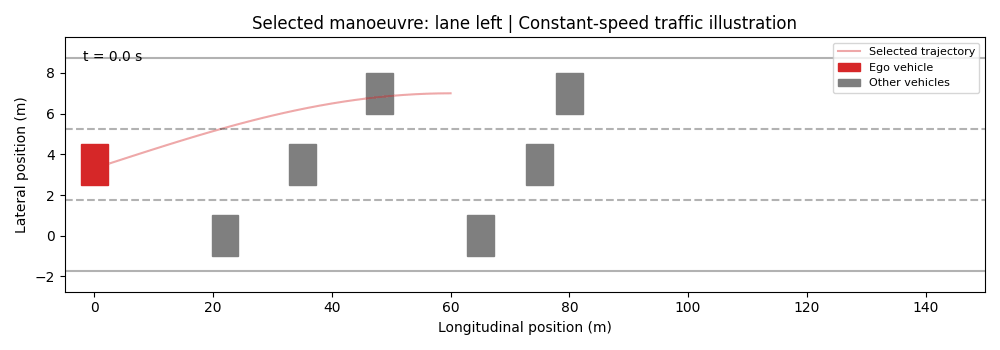
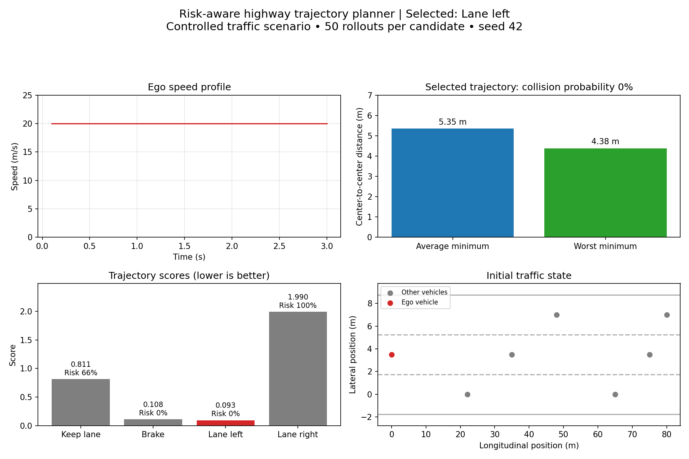

# Risk-Aware Highway Trajectory Planner

A simulation-based trajectory planning framework for autonomous
highway driving, incorporating Monte Carlo collision-risk estimation,
stochastic traffic prediction and multi-objective manoeuvre selection.

Developed as an undergraduate engineering project to explore
decision-making under uncertainty in autonomous driving environments.

## Simulation Demo



The ego vehicle evaluates candidate manoeuvres and selects the
trajectory that minimizes a weighted combination of collision risk,
vehicle proximity and driving comfort.

## Methodology

The planning framework consists of five stages:

1. **Environment modelling:** A three-lane highway environment
   containing an ego vehicle and surrounding traffic.
2. **Trajectory generation:** Generation of four candidate
   manoeuvres — lane keeping, braking, left lane change and
   right lane change.
3. **Stochastic traffic prediction:** Monte Carlo sampling of
   surrounding vehicle trajectories to account for uncertainty.
4. **Collision-risk estimation:** Axis-aligned bounding box
   (AABB) collision detection and minimum-distance evaluation
   across the planning horizon.
5. **Trajectory selection:** Multi-objective scoring based on
   estimated collision probability, proximity and comfort.

### Simulation Parameters

| Parameter | Value |
|---|---|
| Number of lanes | 3 |
| Lane width | 3.5 m |
| Surrounding vehicles | 6 |
| Initial ego speed | 20 m/s |
| Planning horizon | 3 s |
| Simulation timestep | 0.1 s |
| Candidate manoeuvres | 4 |

## Planning Dashboard



The dashboard displays the selected trajectory's speed profile,
estimated collision probability, minimum-distance indicators,
candidate trajectory scores and initial traffic configuration.

The animation and dashboard represent a single illustrative
planning scenario.

## Experimental Evaluation

The planner was evaluated across 200 simulated traffic scenarios
using two traffic configurations, with 100 Monte Carlo rollouts
per candidate manoeuvre.

This corresponds to 80,000 sampled trajectory rollouts.

### Traffic Configurations

| Parameter | Standard | Challenging |
|---|---:|---:|
| Independent scenarios | 100 | 100 |
| Initial vehicle distance | 20–80 m | 8–45 m |
| Surrounding vehicle speed | 15–25 m/s | 5–22 m/s |
| Rollouts per candidate | 100 | 100 |

### Challenging Traffic Results

| Manoeuvre | Mean estimated collision probability | Mean minimum distance (m) |
|---|---:|---:|
| Keep lane | 74.83% | 1.38 |
| Brake | 56.46% | 2.33 |
| Lane left | 82.50% | 1.63 |
| Lane right | 79.40% | 1.69 |
| Planner-selected | **44.59%** | **3.06** |

Compared with a fixed lane-keeping strategy, adaptive trajectory
selection achieved:

- 40.4% relative reduction in mean estimated collision probability.
- Increased mean minimum centre-to-centre distance from
  1.38 m to 3.06 m.
- 65.8% reduction in mean weighted trajectory cost.

In the standard traffic configuration, no collisions were
observed in the sampled rollouts.

These results demonstrate the planner's ability to adapt its
manoeuvre selection under different simulated traffic conditions.
They represent model-based risk estimates rather than validated
real-world safety improvements.

### Experimental Data

- [Standard traffic results](benchmarks/benchmark_results.csv)
- [Challenging traffic results](benchmarks/benchmark_stress_results.csv)

## Repository Structure

```text
risk_aware_planner/
├── assets/          # Simulation animation and dashboard
├── benchmarks/      # Experimental results
├── src/
│   ├── env.py              # Highway environment
│   ├── trajectories.py     # Candidate trajectory generation
│   ├── collision.py        # Collision detection
│   ├── risk.py             # Monte Carlo risk estimation
│   ├── planner.py          # Trajectory scoring and selection
│   ├── visualize.py        # Trajectory visualization
│   ├── dashboard.py        # Planning dashboard
│   ├── benchmark.py        # Standard traffic evaluation
│   ├── benchmark_stress.py # Challenging traffic evaluation
│   └── ...                 # Supporting scripts and tests
├── requirements.txt
└── README.md
```

## Limitations

- Simplified highway geometry and vehicle dynamics.
- Surrounding vehicles follow lane-constrained motion models.
- Fixed candidate manoeuvres and a finite planning horizon.
- Comfort evaluation primarily considers longitudinal motion.
- Collision risk is penalized rather than enforced as a hard
  safety constraint.
- Risk estimates used for trajectory selection are not evaluated
  against an independent validation set.

The framework is intended as a proof of concept for risk-aware
motion planning and decision-making, rather than a deployable
autonomous driving system.

## Technologies

Python | NumPy | Matplotlib | Monte Carlo Simulation |
Motion Planning | Collision Detection
